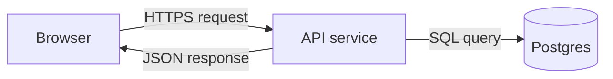

# Mermaid diagrams

Mermaid is text that GitHub renders as a diagram, so diagrams are version-controlled
like code. Put one in the Data flow section inside a fenced block marked `mermaid`.

Tips: label arrows with what moves along them; use `[( )]` for databases; keep to 10 or
fewer boxes, splitting into a second diagram if needed.
